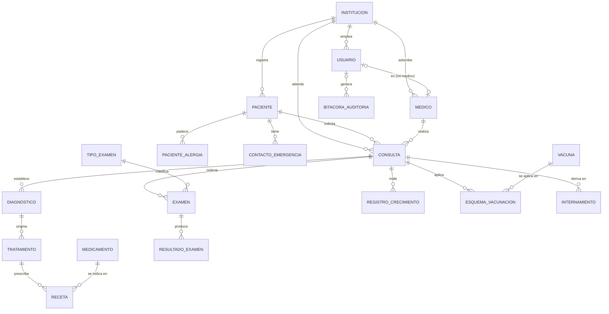
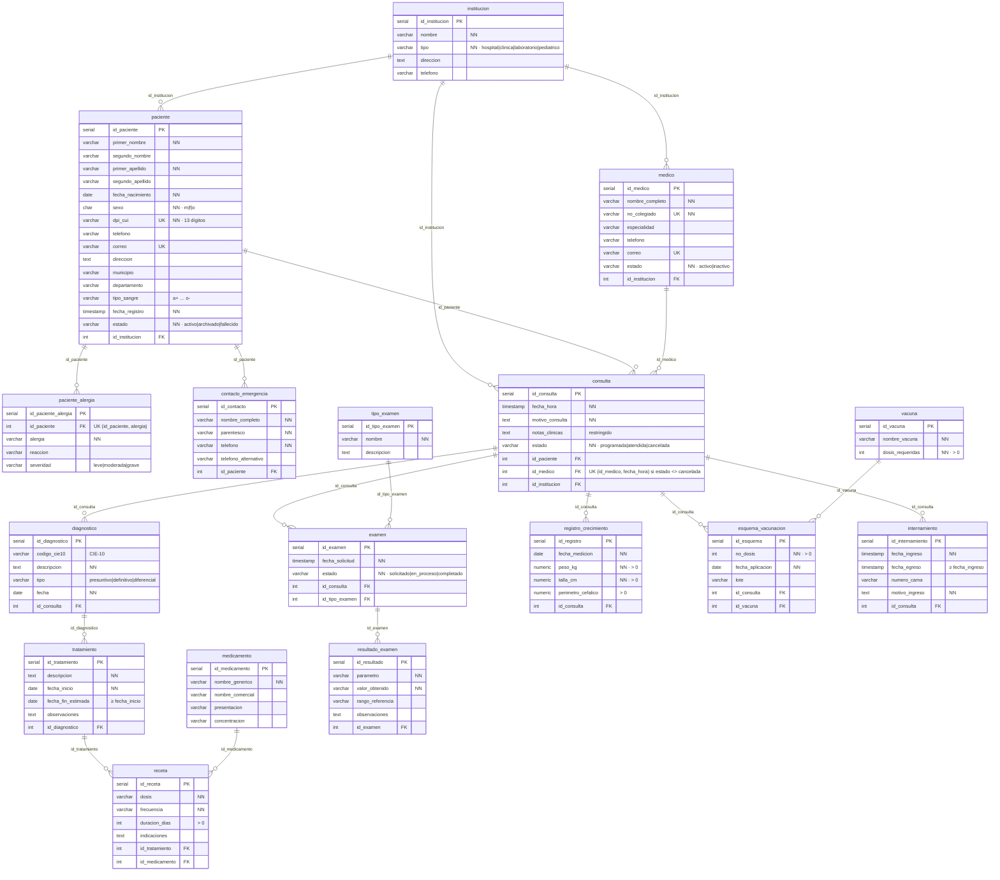
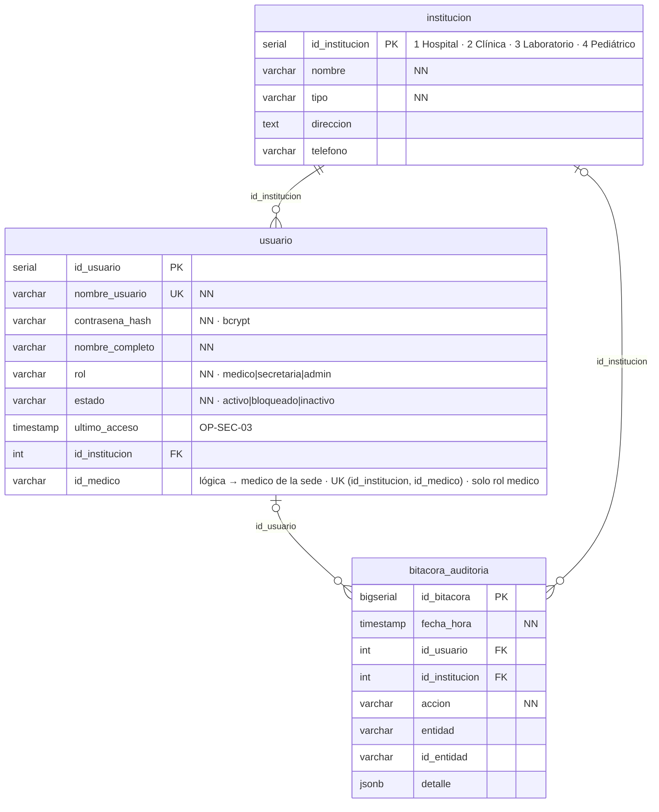
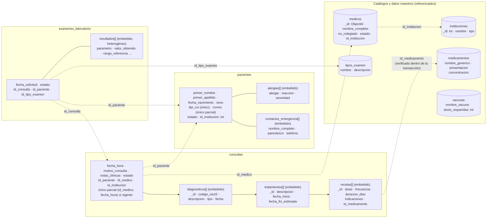
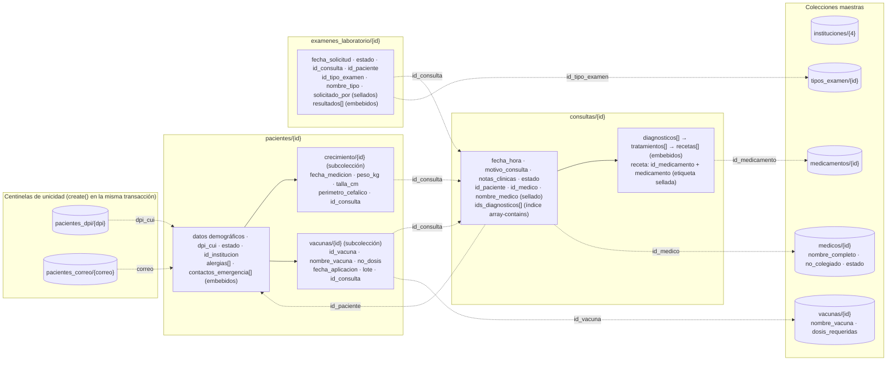
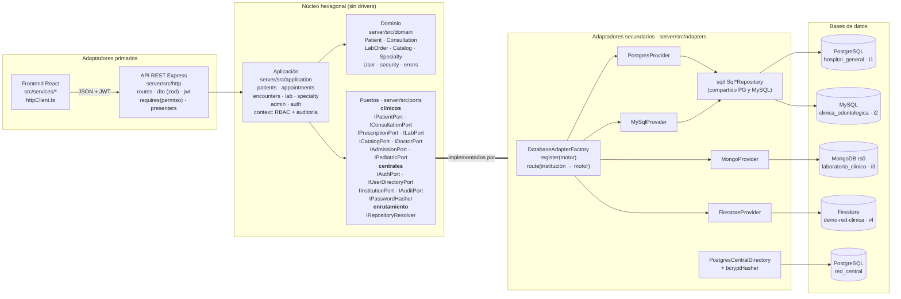
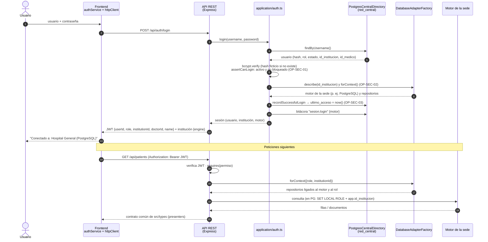
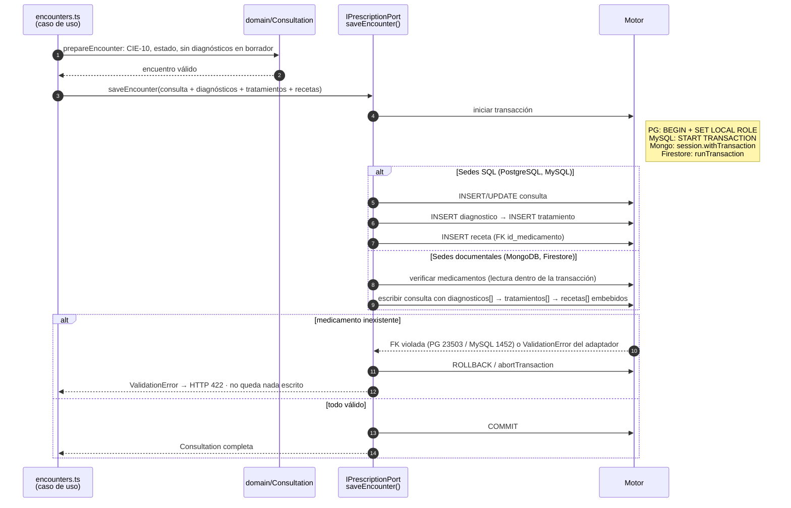

# Diagramas — Red Clínica multi-motor (Entrega II)

Estos diagramas reflejan el sistema **tal como está implementado**. Se generaron a partir de:

- el DDL de `server/db/postgres/01_schema.sql`, `server/db/mysql/01_schema.sql` y `server/db/central/01_schema.sql`;
- los validadores de `server/db/mongo/init.js` y la estructura de `server/db/firestore/seed.ts`;
- el código de `server/src/`.

Reemplazan a los diagramas de la Entrega I enlazados en la sección 8 del PDF. Incorporan las correcciones de `INSTRUCCIONES_ENTREGA_II.md` §2:

- receta como tabla asociativa;
- catálogo de vacunas separado del esquema;
- `estado` e `id_institucion` en paciente y consulta;
- la relación 1:N de institución con usuario, médico, paciente y consulta.

GitHub muestra los bloques Mermaid directamente. En `docs/diagramas/diagrama-N.svg` está cada diagrama exportado en SVG, en el orden de esta lista, para insertarlo en el informe; para regenerarlos, ver el final de este documento.

1. [Diagrama ER (conceptual)](#1-diagrama-er-conceptual)
2. [Diagrama relacional: sedes SQL](#2-diagrama-relacional--sedes-sql-postgresql-y-mysql)
3. [Diagrama relacional: base central `red_central`](#3-diagrama-relacional--base-central-red_central)
4. [Modelo documental: MongoDB](#4-modelo-documental--mongodb-laboratorio-clínico)
5. [Modelo documental: Firestore](#5-modelo-documental--firestore-centro-médico-pediátrico)
6. [Arquitectura hexagonal](#6-arquitectura-hexagonal)
7. [Login y enrutamiento por institución (OP-SEC-01..03)](#7-login-y-enrutamiento-por-institución-op-sec-0103)
8. [Transacción atómica de la consulta (Eje B)](#8-transacción-atómica-de-la-consulta-eje-b)

---

## 1. Diagrama ER (conceptual)

Muestra entidades, relaciones y cardinalidades. `usuario` y `bitacora_auditoria` viven en la base central (§3). Cada sede SQL replica el resto, y los motores documentales lo transforman como se describe en §4 y §5.

La relación `usuario` → `medico` es **lógica**: el médico vive en el motor de su sede, con un id entero, un ObjectId o un id de documento según el motor. Por eso no puede haber una FK entre bases distintas.



| Subsistema | Entidades |
|---|---|
| Administración | `institucion`, `usuario`, `medico`, `bitacora_auditoria` |
| Núcleo clínico | `paciente`, `paciente_alergia`, `contacto_emergencia`, `consulta`, `diagnostico`, `tratamiento`, `receta` |
| Catálogos | `medicamento`, `tipo_examen`, `vacuna` |
| Laboratorio | `examen`, `resultado_examen` |
| Especialidad | `registro_crecimiento`, `esquema_vacunacion` (pediatría) e `internamiento` (hospital) |

---

## 2. Diagrama relacional: sedes SQL (PostgreSQL y MySQL)

Hospital General (`hospital_general`, PostgreSQL) y Clínica Odontológica (`clinica_odontologica`, MySQL) tienen las mismas 17 tablas en 3FN. Todas las FK son `NOT NULL` y `ON DELETE RESTRICT`; el borrado es lógico, mediante `estado`.



**Diferencias entre los dos motores** (mismo modelo lógico):

| Aspecto | PostgreSQL (`hospital_general`) | MySQL (`clinica_odontologica`) |
|---|---|---|
| PK | `serial` | `INT AUTO_INCREMENT` |
| Horario único del médico | Índice único **parcial** `uq_consulta_horario_medico (id_medico, fecha_hora) WHERE estado <> 'cancelada'` | Columna generada `horario_vigente` (1 o `NULL`) dentro de `UNIQUE (id_medico, fecha_hora, horario_vigente)` |
| Vistas | `v_agenda` y `v_historial_farmacoterapeutico`, ambas `security_invoker` | `v_agenda` (`SQL SECURITY INVOKER`) |
| Seguridad en el motor | Roles `rc_medico`, `rc_secretaria`, `rc_admin`; privilegios por columna en `consulta`; RLS por `app.id_institucion` en `paciente`, `consulta` y `medico` | La agenda de secretaría y admin solo se lee desde `v_agenda`; el resto se filtra en el adaptador |

---

## 3. Diagrama relacional: base central `red_central`

Es el directorio de seguridad en PostgreSQL. El login ocurre **antes** de conocer el motor de la sede (OP-SEC-02), así que los usuarios no pueden vivir dentro de cada sede.



---

## 4. Modelo documental: MongoDB (Laboratorio Clínico)

Base `laboratorio_clinico`, en un replica set `rs0` (lo requieren las transacciones). Lo que crece sin límite se **referencia** y lo acotado se **embebe**; la justificación está en [`modelo-nosql.md`](modelo-nosql.md). Las 7 colecciones llevan validadores `$jsonSchema` estrictos.



Línea continua: el subdocumento se embebe. Línea punteada: referencia por id. MongoDB no tiene FK, así que el adaptador comprueba la referencia dentro de la transacción.

---

## 5. Modelo documental: Firestore (Centro Médico Pediátrico)

Proyecto `demo-red-clinica` en el emulador. Usa subcolecciones por paciente para las series temporales pediátricas y desnormaliza selectivamente para ahorrar lecturas. Firestore no tiene índices únicos, así que la unicidad se logra con documentos centinela.



La seguridad se declara en `firestore.rules`, según `request.auth.token.role` y `institutionId`. El backend usa `firebase-admin`, que omite esas reglas, y por eso también aplica el mismo RBAC en la capa de aplicación.

---

## 6. Arquitectura hexagonal

Las flechas son dependencias de código. El dominio y la aplicación dependen **solo de los puertos**. Los adaptadores secundarios implementan esos puertos (enlace grueso): los 4 proveedores, los puertos clínicos; `PostgresCentralDirectory`, los centrales; y `DatabaseAdapterFactory`, `IRepositoryResolver`. `container.ts` es la raíz de composición y el único lugar que conoce los drivers.



La misma suite de contrato (`server/test/contract.ts`) se ejecuta contra los 4 proveedores, lo que verifica el principio de sustitución de Liskov. Para agregar un 5.º motor basta con `factory.register(...)` y `route(...)`, sin tocar los casos de uso (principio abierto/cerrado).

---

## 7. Login y enrutamiento por institución (OP-SEC-01..03)



---

## 8. Transacción atómica de la consulta (Eje B)

Al guardar una consulta, la consulta, los diagnósticos, los tratamientos y las recetas se escriben **todos o ninguno**. El diagrama muestra el caso de error que verifica `engines.test.ts`: una receta con un medicamento inexistente revierte todo lo anterior.



---

## Regenerar las imágenes

Los archivos `docs/diagramas/*.svg` se generan desde los bloques Mermaid de este documento con [`@mermaid-js/mermaid-cli`](https://github.com/mermaid-js/mermaid-cli):

```bash
npx -y @mermaid-js/mermaid-cli@11.4.2 -i docs/diagramas.md -o docs/diagramas/diagrama.svg
```

El comando crea un archivo por bloque (`diagrama-1.svg` … `diagrama-8.svg`), en el orden de las secciones. Para obtener PNG, cambie la extensión de salida a `.png` y agregue `-w 1800 -s 2 -b white`. El repositorio envía los `*.png` a Git LFS (`.gitattributes`), así que no se versionan.
